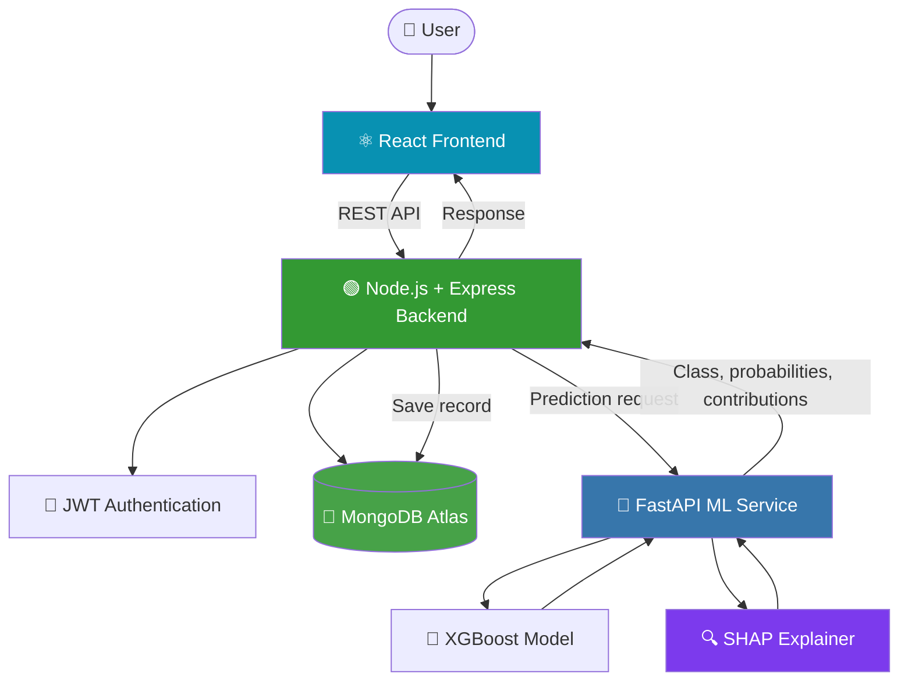

<div align="center">


[](https://github.com/charandonthula/FetoWatch-AI)
[](#-important-disclaimer)
[](#-machine-learning)
[](#-explainable-ai-with-shap)

> **FetoWatch AI** is a full-stack application that combines an **XGBoost** classifier with **SHAP explanations**, so users can see not just *what* the model predicts, but *why*.


</div>

---

## ⚠️ Important Disclaimer

> **FetoWatch AI is an educational and experimental prototype.** It is **not** a clinically validated medical device, does not provide medical diagnoses, and **must not** be used for patient-care decisions. Predictions and SHAP explanations exist only to demonstrate machine learning and explainability concepts.

---

## 📖 Overview

Cardiotocography (CTG) records fetal heart rate and uterine contractions. This project uses a public fetal health dataset to train a three-class classifier, then wraps it in a complete web application.

| Class | Label | Meaning |
|:---:|:---:|:---|
| 1 | 🟢 **Normal** | Normal CTG pattern in the dataset |
| 2 | 🟡 **Suspect** | Suspect CTG pattern in the dataset |
| 3 | 🔴 **Pathological** | Pathological CTG pattern in the dataset |

Rather than stopping at a notebook, FetoWatch AI delivers the full workflow: **authentication → input → prediction → explanation → history management**.

---

## ✨ Features

<table>
  <tr>
    <td width="50%" valign="top">

### 🔐 Authentication
- Registration and login
- Passwords hashed with bcrypt
- JWT-based authentication
- Protected frontend routes and API endpoints
- User-specific prediction records
- Logout confirmation

### 🧪 CTG Prediction
- Structured form with **21 CTG features**
- Input validation
- Sample CTG profiles for demos
- Three-class prediction output
- Class probability visualization

    </td>
    <td width="50%" valign="top">

### 🧠 Explainable AI
- SHAP-based feature contributions
- Top contributing features displayed
- Visual explanation of model behaviour

### 📊 Dashboard and History
- Prediction statistics and class distribution
- Recent records and pending notifications
- Search by ID or predicted class
- Filter by class and review status
- Update review status
- Delete one record or clear all history

### 🎨 Interface
- Responsive layout with sidebar navigation
- Light and dark themes (saved preference)
- Confirmation dialogs for destructive actions
- Loading, error and empty states

    </td>
  </tr>
</table>

---

## 🏗️ System Architecture

FetoWatch AI has three independent layers: a **React** frontend, a **Node.js/Express** backend, and a **Python/FastAPI** ML service.



**Why two backends?** Express handles authentication and database logic, while FastAPI handles model inference and SHAP. This keeps the ML model independent of the web layer, and each service can be developed and tested separately.

---

## 🔄 Application Workflow

```text
 1. Register / Log in
 2. Open the Dashboard
 3. Go to "New Prediction" and enter 21 CTG values (or load a sample profile)
 4. Frontend → Express backend (JWT attached)
 5. Backend → FastAPI ML service
 6. XGBoost predicts the class and probabilities
 7. SHAP computes feature contributions
 8. Backend saves the record against the user in MongoDB
 9. Frontend shows the result with explanations
10. Revisit any record later in Prediction History
```

---

## 🛠️ Tech Stack

| Layer | Technologies |
|:---|:---|
| **Frontend** | React, Vite, JavaScript, Tailwind CSS, React Router, Axios, Recharts, Lucide React |
| **Backend** | Node.js, Express.js, Mongoose, JWT, bcryptjs |
| **Database** | MongoDB Atlas |
| **ML Service** | Python, FastAPI |
| **Machine Learning** | XGBoost, SHAP, Pandas, NumPy |
| **Experimentation** | Jupyter Notebook |
| **Version Control** | Git and GitHub |

---

## 🤖 Machine Learning

### Dataset
The project uses the public **Kaggle Fetal Health Classification** dataset: **2,126 records**, **21 input features**, and **3 target classes**.

### Preprocessing

| Step | Detail |
|:---|:---|
| Data inspection | Structure, distributions, missing values, duplicates |
| Duplicate removal | **13** duplicate records removed → **2,113** retained |
| Label encoding | `1 → 0`, `2 → 1`, `3 → 2` |
| Split | **80/20 stratified** train-test split |

| Dataset | Records |
|:---|---:|
| Training | 1,690 |
| Testing | 423 |
| **Total** | **2,113** |

### Model
Several algorithms were compared in `03_model_comparison.ipynb`, and **XGBoost** was selected for the inference service.

> **Evaluation note:** The test set was used during model comparison and tuning, so reported test performance should not be treated as an independent final evaluation. A separate external validation dataset would be needed for a reliable estimate of generalization.

---

## 🔍 Explainable AI with SHAP

SHAP (SHapley Additive exPlanations) estimates how much each feature contributed to a model's output for a single prediction.

| SHAP provides | SHAP does **not** provide |
|:---|:---|
| Which features influenced a prediction | Medical causation |
| Positive and negative contribution values | Clinical significance |
| Insight into model behaviour per input | Proof that a prediction is correct |

The `/explain` endpoint returns the predicted class, class probabilities, top feature contributions, and a disclaimer in one response.

---

## 📁 Repository Structure

```text
FetoWatch-AI/
├── backend/                  # Node.js + Express API
│   ├── config/db.js
│   ├── controllers/          # authController, predictionController
│   ├── middleware/           # authMiddleWare (JWT)
│   ├── models/               # User, Prediction
│   ├── routes/               # authRoutes, predictionRoutes
│   ├── services/mlService.js # Talks to the ML service
│   └── server.js
│
├── frontend/                 # React + Vite app
│   └── src/
│       ├── components/       # common/ProtectedRoute, layout/(Layout, Sidebar, Topbar)
│       ├── context/          # AuthContext
│       ├── data/             # sampleProfiles
│       ├── pages/            # Login, Register, Dashboard, NewPrediction,
│       │                     # PredictionResult, History
│       └── services/api.js   # Axios client
│
├── ml-service/               # FastAPI inference service
│   ├── app/                  # main.py, model_loader.py
│   └── requirements.txt
│
├── ml-training/              # Model development
│   ├── data/                 # raw/ and processed/
│   ├── models/               # fetowatch_xgb.json, model_metadata.json
│   └── notebooks/            # 01 → 04 (dataset, preprocessing, comparison, SHAP)
│
└── README.md
```

---

## 🚀 Getting Started

### Prerequisites
- Git
- Node.js and npm
- Python 3
- A MongoDB Atlas account (or compatible MongoDB deployment)

### 1️⃣ Clone the repository

```bash
git clone https://github.com/charandonthula/FetoWatch-AI.git
cd FetoWatch-AI
```

### 2️⃣ Install dependencies

<details>
<summary><b>🟢 Backend</b></summary>

```bash
cd backend
npm install
```
</details>

<details>
<summary><b>⚛️ Frontend</b></summary>

```bash
cd frontend
npm install
```
</details>

<details>
<summary><b>🐍 ML Service</b></summary>

```bash
cd ml-service
python -m venv .venv

# Windows
.venv\Scripts\activate
# Linux / macOS
source .venv/bin/activate

pip install -r requirements.txt
```
</details>

### 3️⃣ Configure environment variables

**`backend/.env`**

```env
PORT=5000
MONGO_URI=your_mongodb_connection_string
JWT_SECRET=your_secure_random_secret
ML_SERVICE_URL=http://localhost:8000
```

**`frontend/.env`**

```env
VITE_API_URL=http://localhost:5000/api
```

> 🔒 Never commit `.env` files, database passwords, or your JWT secret.
> The variable names above must match the ones your code actually reads.

### 4️⃣ Run all three services

Start each in its own terminal, in this order:

| Order | Service | Commands | Default URL |
|:---:|:---|:---|:---|
| 1 | 🐍 **ML Service** | `cd ml-service` then `uvicorn app.main:app --reload` | `http://localhost:8000` |
| 2 | 🟢 **Backend** | `cd backend` then `npm run dev` | `http://localhost:5000` |
| 3 | ⚛️ **Frontend** | `cd frontend` then `npm run dev` | `http://localhost:5173` |

FastAPI interactive docs are available at `http://localhost:8000/docs`.

---

## 📡 API Reference

Base URL: `http://localhost:5000/api`

Protected endpoints need this header:

```http
Authorization: Bearer YOUR_JWT_TOKEN
```

<details>
<summary><b>🔐 Authentication</b></summary>

| Method | Endpoint | Description | Auth |
|:---:|:---|:---|:---:|
| `POST` | `/auth/register` | Register a new account | ❌ |
| `POST` | `/auth/login` | Log in | ❌ |
| `GET` | `/auth/me` | Get current user | ✅ |

</details>

<details>
<summary><b>🧪 Predictions</b></summary>

| Method | Endpoint | Description | Auth |
|:---:|:---|:---|:---:|
| `POST` | `/predictions` | Generate and save a prediction | ✅ |
| `GET` | `/predictions` | List your prediction history | ✅ |
| `GET` | `/predictions/:id` | Get one prediction | ✅ |
| `PATCH` | `/predictions/:id/status` | Update review status | ✅ |
| `DELETE` | `/predictions/:id` | Delete one prediction | ✅ |
| `DELETE` | `/predictions` | Clear all your predictions | ✅ |

Allowed review statuses: `pending`, `reviewed`, `flagged`. These are workflow labels only, not clinical review.

</details>

<details>
<summary><b>🐍 ML Service</b></summary>

| Method | Endpoint | Description |
|:---:|:---|:---|
| `GET` | `/` | Service information |
| `GET` | `/health` | Health check |
| `POST` | `/predict` | Classification prediction |
| `POST` | `/explain` | Prediction with SHAP explanations |

</details>

---

## 🔒 Security

| Area | Approach |
|:---|:---|
| **Passwords** | Hashed with bcrypt before storage |
| **Sessions** | JWT-based authentication |
| **Frontend** | Protected routes block unauthenticated pages |
| **Backend** | Middleware independently validates every protected request |
| **Data isolation** | Queries use the authenticated user's ID, so users cannot read, update or delete each other's records |

> Frontend confirmation dialogs are a usability safeguard, not a security control. Real access restrictions are enforced by the backend.

---

## 🚧 Limitations

- **Dataset:** Trained on one public dataset, so results may not generalize to other populations, clinics or devices.
- **Evaluation:** The test set was used during tuning, so an independent final evaluation is still needed.
- **Clinical:** Not clinically validated or regulator-approved. Never use for diagnosis or patient care.
- **Explainability:** SHAP explains the model, not the underlying medical condition.
- **Input quality:** Unrealistic inputs can produce misleading outputs.
- **Deployment:** Built as a local development prototype and would need more security, monitoring and validation for production.

---

## 🔮 Roadmap

```text
✅ Completed
   ✔ XGBoost model with SHAP explanations
   ✔ FastAPI inference service
   ✔ JWT authentication and protected routes
   ✔ Dashboard, history, search and filters
   ✔ Light / dark theme

🚧 Planned
   ⬜ Independent external model validation
   ⬜ Automated backend and frontend tests
   ⬜ Improved input validation
   ⬜ Prediction export
   ⬜ Audit logging
   ⬜ Accessibility improvements
   ⬜ Production deployment and monitoring
```

---

## 🤝 Contributing

Suggestions and contributions are welcome.

1. Fork the repository
2. Create a feature branch: `git checkout -b feature/your-feature`
3. Make and test your changes
4. Commit: `git commit -m "feat: describe your change"`
5. Push and open a pull request

Please do not commit `.env` files, credentials, virtual environments or `node_modules`.

---

## 🙏 Acknowledgements

- **Kaggle** for the public Fetal Health Classification dataset
- The maintainers of **React, Node.js, Express, MongoDB, Python, FastAPI, XGBoost and SHAP**

---

## 👨‍💻 Author

<div align="center">

### Charan Donthula

[](https://github.com/charandonthula)
[](https://www.linkedin.com/in/charan-donthula-71a341361/)
[](https://leetcode.com/u/charan_995/)

<br/>

> *This project is for educational and research demonstration only. It is not a medical device and must not be used for clinical decision-making.*


**⭐ If you found this project interesting, consider giving it a star!**

</div>